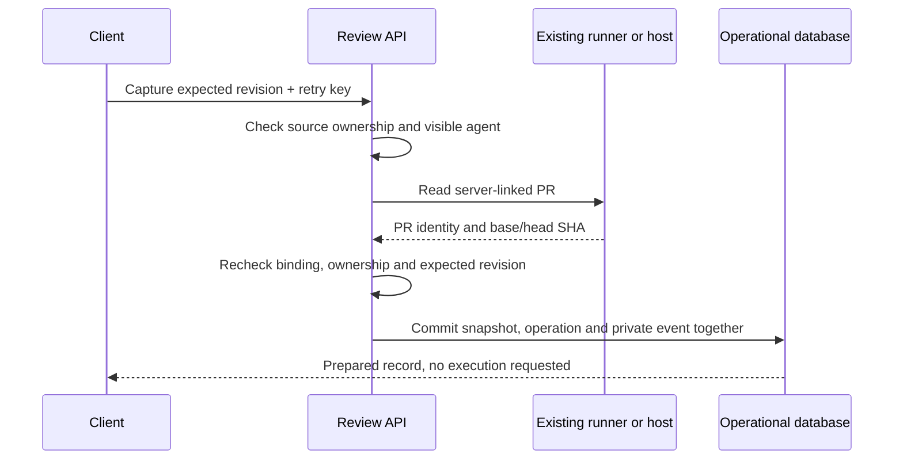

# Private review records

The capture API creates a durable review record before agent execution. Each
record freezes the linked PR's base and head SHA, source
session, host, workspace, agent version, harness, skill name and optional model
settings. Existing session, agent and resource services supply this context.



## Capture a record

Start this fork using the [local setup](README.md#local-checkout). Choose an
owned session with a host and workspace, then attach a GitHub PR in its existing
PR panel. The PR association must have synchronized before capture succeeds.

Send this request to that instance using its existing authentication. Replace
the placeholders with the source session ID, a visible agent ID and the full
base/head SHAs displayed for the selected PR. Select the existing review skill
you intend to run later. Use a new key for a new capture, and retain the same key
and body for retries.

```http
POST /v1/sessions/SOURCE_SESSION_ID/studio/reviews
Content-Type: application/json
Idempotency-Key: kvark-pr-17-review-1

{
  "pr_url": "https://github.com/YOUR_ORG/YOUR_REPO/pull/17",
  "expected_base_sha": "FULL_BASE_SHA",
  "expected_head_sha": "FULL_HEAD_SHA",
  "agent_id": "VISIBLE_AGENT_UUID",
  "harness": "codex-native",
  "skill": "review"
}
```

A new capture returns HTTP 201 with `created: true`. Its review has
`state: "prepared"`, `dispatch_status: "not_requested"` and
`reviewer_session_id: null`. Its `review.capture` operation is `succeeded`,
meaning that capture was committed. No reviewer session was created.

An exact retry returns HTTP 200, `created: false` and the original record.
It does not refresh the frozen PR revision or agent version. A reused key with
a different body returns 409. A changed PR revision or session binding also
returns 409; refresh the context and create a new capture. Unavailable PR access
or unsynchronized association data blocks capture rather than creating a
partially verified record.

## Read and reconnect

| Endpoint | Result |
| --- | --- |
| `GET /v1/sessions/{source_session_id}/studio/reviews` | Owned source's records, with `limit` and `after_id` pagination |
| `GET /v1/studio/reviews/{review_id}` | Durable snapshot and current state |
| `GET /v1/studio/reviews/{review_id}/operations/{operation_id}` | One operation's status |
| `GET /v1/studio/reviews/{review_id}/events?after_sequence=0` | Private ordered events, with `limit` and `next_cursor` pagination |
| `GET /v1/studio/reviews/{review_id}/report` | Pending, incomplete or ready report from the bound reviewer session |

Capture and source listing require source ownership. Review records, operations
and events are independently scoped to their capture owner and workspace.
Sharing a source session does not share its reviews. Other readers, editors and
administrators do not gain access through their source-session privileges.
With authentication disabled, the ledger uses an anonymous instance owner.
That owner remains separate from named users and the authenticated `local` user.

After restarting the server against the same database, read the same review ID
and resume event polling. Follow `next_cursor` while draining existing pages.
Once it is null, retain the last event's `sequence` as `after_sequence` for later
polls. Review events are not broadcast into the source
session's shared event stream. The checked-in [OpenAPI contract](../../openapi.json)
describes request and response fields.

## Start and read a native review

The PR panel performs these steps after **Run review**. For a direct API call,
capture a record with the built-in Codex or Claude Code agent ID and a skill
available on the owned host. Then send:

```http
POST /v1/studio/reviews/REVIEW_ID/start
Content-Type: application/json
Idempotency-Key: kvark-pr-17-start-1

{}
```

Omnigent checks the current source binding, PR revision, agent version, host
readiness and complete skill inventory. It reads the bounded text diff through
the existing PR transport and claims one attempt before creating a private root
session. The new session uses the captured workspace and normal native agent
permissions. Its first input supplies the diff as review evidence. Codex uses
its native skill mention. Claude Code receives an explicit request to load the
skill with its native Skill tool.

| `dispatch_status` | Meaning |
| --- | --- |
| `not_requested` | Captured and available to start |
| `dispatching` | Start claimed, confirmation pending |
| `running` | Native input acknowledgement received. Read the report separately |
| `unknown` | Start or delivery confirmation was lost. Inspect the reviewer session if available |

Retrying the same start key returns the existing attempt. Each capture allows
one start claim even across reconnects. A reserved reviewer session ID can
exist before its session is created. A different key cannot repeat an uncertain
start. The caller can inspect the original session and decide what to do next.

The report comes from the latest eligible assistant reply in that session. A
ready result contains one `studio-review-v1` JSON block bound to the review ID
and both captured SHAs. Claude Code also requires the same turn's matching
Skill tool launch receipt. Malformed or interrupted output stays incomplete and
can be repaired in the same conversation. Omnigent validates the report shape
and relative file coordinates. The UI resolves a finding to a displayed diff
line only when the selected PR revision and the loaded patch match the capture.
Old-side lines use the patch's merge-base coordinates and open in **Changes**.
The transcript is the durable source for the report. A ready report represents
an agent assessment and carries no executed check receipt.
