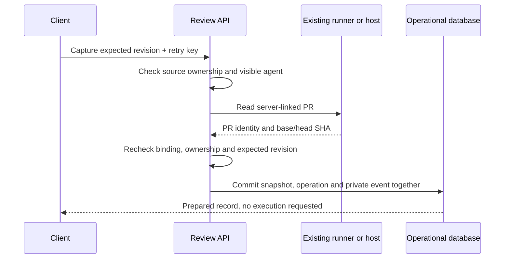

# Private review records

The capture API creates a durable review record before agent execution is
implemented. Each record freezes the linked PR's base and head SHA, source
session, host, workspace, agent version, harness, skill name and optional model
settings. Existing session, agent and resource services supply this context.



## Capture a record

Start this fork using the [local setup](README.md#local-checkout). Choose an
owned session with a host and workspace, then attach a GitHub PR in its existing
PR panel. The PR association must have synchronized before capture succeeds.

Send this request to that instance using its existing authentication. Replace
the placeholders with the source session ID, a visible agent ID and the full
base/head SHAs displayed for the selected PR. Select the existing review skill
you intend to run later. Use a new key for a new capture, and retain the same key
and body for retries.

```http
POST /v1/sessions/SOURCE_SESSION_ID/studio/reviews
Content-Type: application/json
Idempotency-Key: kvark-pr-17-review-1

{
  "pr_url": "https://github.com/YOUR_ORG/YOUR_REPO/pull/17",
  "expected_base_sha": "FULL_BASE_SHA",
  "expected_head_sha": "FULL_HEAD_SHA",
  "agent_id": "VISIBLE_AGENT_UUID",
  "harness": "codex-native",
  "skill": "review"
}
```

A new capture returns HTTP 201 with `created: true`. Its review has
`state: "prepared"`, `dispatch_status: "not_requested"` and
`reviewer_session_id: null`. Its `review.capture` operation is `succeeded`,
meaning that capture was committed. No reviewer session was created.

An exact retry returns HTTP 200, `created: false` and the original record.
It does not refresh the frozen PR revision or agent version. A reused key with
a different body returns 409. A changed PR revision or session binding also
returns 409; refresh the context and create a new capture. Unavailable PR access
or unsynchronized association data blocks capture rather than creating a
partially verified record.

## Read and reconnect

| Endpoint | Result |
| --- | --- |
| `GET /v1/sessions/{source_session_id}/studio/reviews` | Owned source's records, with `limit` and `after_id` pagination |
| `GET /v1/studio/reviews/{review_id}` | Durable snapshot and current state |
| `GET /v1/studio/reviews/{review_id}/operations/{operation_id}` | One operation's status |
| `GET /v1/studio/reviews/{review_id}/events?after_sequence=0` | Private ordered events, with `limit` and `next_cursor` pagination |

Capture and source listing require source ownership. Review records, operations
and events are independently scoped to their capture owner and workspace.
Sharing a source session does not share its reviews. Other readers, editors and
administrators do not gain access through their source-session privileges.
With authentication disabled, the ledger uses an anonymous instance owner.
That owner remains separate from named users and the authenticated `local` user.

After restarting the server against the same database, read the same review ID
and resume event polling. Follow `next_cursor` while draining existing pages.
Once it is null, retain the last event's `sequence` as `after_sequence` for later
polls. Review events are not broadcast into the source
session's shared event stream. The checked-in [OpenAPI contract](../../openapi.json)
describes request and response fields.

## Execution boundary

The store includes atomic operation reservation, a single dispatch claim,
version checks and explicit reconciliation. A start whose outcome is unknown
cannot be retried by changing its key. These are internal groundwork for A3;
there is no public start, cancel or publish endpoint yet.

A3 must recheck the captured target and revision, qualify the selected native
harness and skill, and bind a separate reviewer session before dispatch. A2
does not establish skill contents, integration permissions, current PR
freshness, review findings, test proofs or GitHub publication.

To verify the visible behavior now, capture a linked PR, repeat the identical
request, change its body while retaining the key, restart the local server and
read the original ID. Expect 201, 200, 409 and the original snapshot. In an
authenticated test instance, a different user should receive 404 for that ID.
